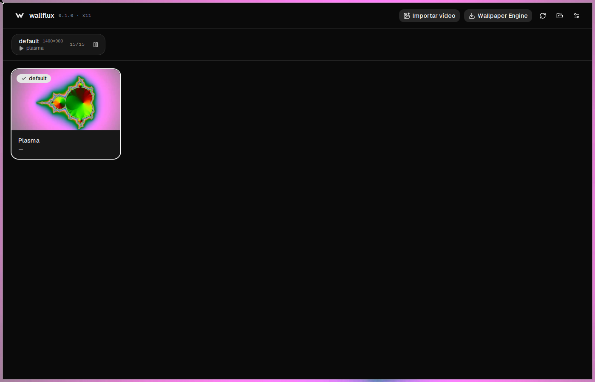
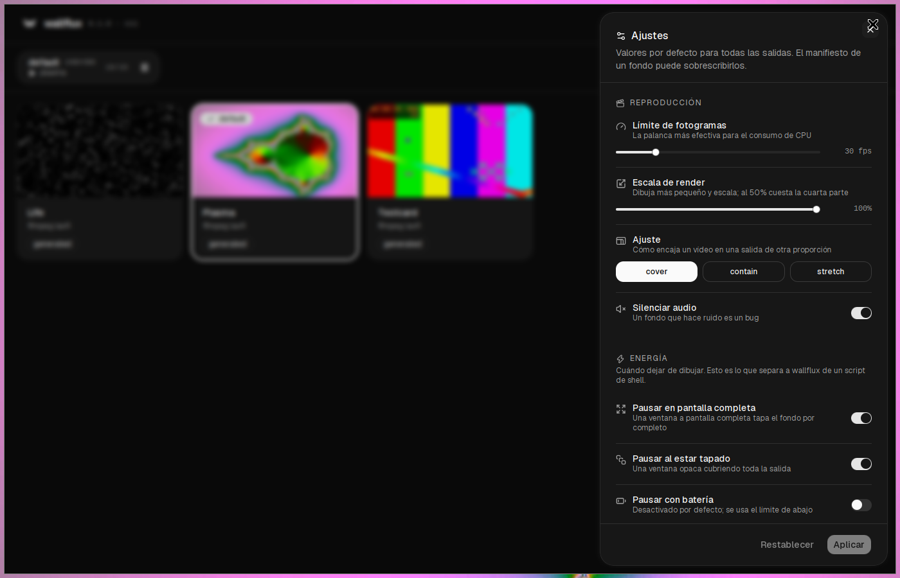
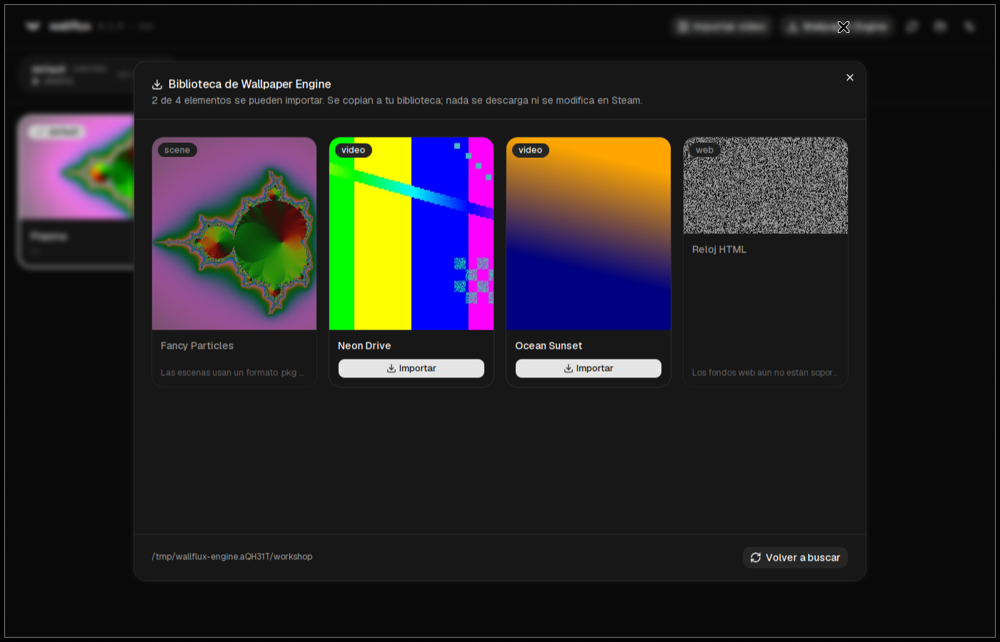

<p align="center">
  
</p>

<h1 align="center">wallflux</h1>

<p align="center">
  Fondos de pantalla animados para Linux — en X11 y en compositores wlroots —
  que dejan de dibujar cuando nadie los ve.
</p>

<p align="center">
  <a href="https://github.com/bolado-dev/wallflux/actions/workflows/ci.yml"></a>
  
  
  
</p>

<p align="center">
  
</p>

---

## Por qué

Poner un vídeo de fondo en Linux suele significar `xwinwrap` más una línea de
`mpv` escrita a mano. Funciona hasta que quieres un segundo monitor, una
interfaz gráfica, o que el fondo deje de quemar un núcleo mientras juegas a
pantalla completa. Wallpaper Engine resuelve todo eso, es excelente, y es
propietario, pensado para Windows y se vende en Steam.

wallflux es la versión libre y pequeña de la parte útil:

- **Deja de dibujar cuando el fondo no se ve.** Una ventana maximizada, un
  layout monocle, un vídeo a pantalla completa: el daemon pausa mpv, así que
  también para de decodificar. Esta es la función que un script de shell no
  puede tener.
- **Un daemon, todos los monitores.** Fondo, límite de fps y escalado por
  salida, con conexión y desconexión en caliente.
- **Un formato de paquete abierto.** Un fondo es una carpeta con un manifiesto
  TOML y un vídeo. Sin base de datos, sin cifrado, sin cuenta.
- **Interfaz gráfica, CLI y socket.** Usa la que te encaje; las tres mandan
  sobre el mismo daemon.
- **Importa desde Wallpaper Engine** los fondos de vídeo que ya tengas.

## Estado

Alpha, y lo dice de frente:

| Área | Estado |
| --- | --- |
| Backend X11 | Funciona; desarrollado contra bspwm + picom |
| Backend Wayland (`wlr-layer-shell`) | Implementado, **sin probar aún en un compositor real** |
| Fondos de vídeo | Funcionan |
| Fondos de shader (tipo Shadertoy) y web | Sin empezar; el formato de paquete les reserva sitio |
| Interfaz gráfica | Funciona: biblioteca, destino por salida, ajustes en vivo |
| Importar de Wallpaper Engine | Solo elementos de vídeo; ver más abajo |

## Cómo funciona

```
                    ┌──────────────┐        ┌─────────────┐
  wallfluxctl ────▶ │              │        │  libmpv     │
  GUI (Tauri)  ────▶│  wallflux-   │───────▶│  render API │
                    │   daemon     │        └──────┬──────┘
  config.toml  ────▶│              │               │ dibuja en
                    └──────┬───────┘               ▼
                           │              ┌─────────────────┐
         superficies desde │              │  superficie EGL │
                           ▼              └────────┬────────┘
            ┌──────────────────────────┐           │
            │ X11: override-redirect   │◀──────────┘
            │ Wayland: layer surface   │
            └──────────────────────────┘
```

Tres decisiones dan forma a todo lo demás:

**La render API de mpv, no incrustar con `--wid`.** mpv dibuja en un
framebuffer que es nuestro, así que el renderizador no sabe nada de X11 ni de
Wayland y los dos backends lo comparten. Con `--wid` habría sido más simple y
solo para X11.

**Nada se enlaza en tiempo de compilación.** libmpv, libEGL y libwayland se
abren con `dlopen` al arrancar. El daemon compila en una máquina sin cabeceras
de desarrollo, funciona contra la versión que traiga la distro, y dice
`instala libmpv2` en vez de morir con un error del enlazador.

**La visibilidad es problema del backend, y cada uno la resuelve distinto.**
Wayland la da gratis: una layer surface solo recibe frame callbacks cuando el
compositor quiere un fotograma, así que un fondo tapado deja de recibirlos.
X11 tiene que deducirlo, vigilando el árbol de ventanas y comparando
geometrías contra cada salida. La prueba en X11 es deliberadamente
conservadora — una salida cuenta como tapada solo cuando **una sola** ventana
opaca la cubre entera — porque bajo un gestor de ventanas en mosaico con gaps
el fondo normalmente sigue viéndose cuando dos ventanas "cubren" la pantalla
entre las dos.

## Instalación

```sh
git clone https://github.com/bolado-dev/wallflux
cd wallflux
./install.sh
```

El script instala las librerías de ejecución con tu gestor de paquetes, añade
un toolchain de Rust si no tienes, compila, instala en `~/.local/bin` y mete
ese directorio en tu `PATH` dentro del fichero de arranque de tu shell, para
que sobreviva a un reinicio.

```
./install.sh --with-gui     # compila e instala también la interfaz
./install.sh --service      # instala además un servicio de usuario de systemd
./install.sh --no-deps      # no toca los paquetes del sistema
./install.sh --uninstall    # quita los binarios; --purge borra también tus datos
```

A mano son cuatro líneas. Las dependencias de ejecución son `libmpv2`,
`libegl1`, `ffmpeg` para las miniaturas, y `libwayland-egl1` en Wayland. No
hay que instalar ningún paquete `-dev`: todo se carga con `dlopen`.

```sh
sudo apt install libmpv2 libegl1 ffmpeg libwayland-egl1
cargo install --path crates/wallflux-daemon
cargo install --path crates/wallflux-cli
```

Para ver qué alcanza wallflux antes de arrancarlo:

```sh
$ wallflux-daemon --check
libmpv:      ok
backend:     x11
salida:      eDP-1 2880x1800 en 0,0 (escala 1)
config:      ~/.config/wallflux/config.toml
biblioteca:  ~/.local/share/wallflux/wallpapers
socket:      /run/user/1000/wallflux/daemon.sock
```

## Uso

```sh
# Un vídeo suelto ya es un fondo; no hace falta manifiesto.
cp ~/Vídeos/neon-city.mp4 ~/.local/share/wallflux/wallpapers/

wallflux-daemon &
wallfluxctl list
wallfluxctl set neon-city
wallfluxctl set neon-city --output DP-2     # solo un monitor
wallfluxctl toggle                          # va bien en un atajo de teclado
wallfluxctl status
```

```
$ wallfluxctl status
wallflux 0.1.0 en x11, lleva 4m 12s
config:     /home/tu/.config/wallflux/config.toml
biblioteca: /home/tu/.local/share/wallflux/wallpapers

SALIDA       TAMAÑO       FONDO                FPS       ESTADO
eDP-1        2880x1800    neon-city            30/30     reproduciendo
DP-2         1920x1080    waves                —         en pausa: tapado por ventanas
```

### Arranque automático

bspwm, en `~/.config/bspwm/bspwmrc`:

```sh
wallflux-daemon &
```

sway / Hyprland:

```
exec wallflux-daemon
```

Servicio de usuario de systemd, si lo prefieres:

```sh
cp packaging/wallflux.service ~/.config/systemd/user/
systemctl --user enable --now wallflux
```

## La interfaz

```sh
wallflux-gui
```

<p align="center">
  
</p>

Hecha con React, Tailwind y [shadcn/ui](https://ui.shadcn.com) sobre la base
`neutral`, que es escala de grises por definición: el único color de la
ventana son los propios fondos, que es justo lo que has venido a mirar. Un
único token `--radius` gobierna todas las esquinas de la aplicación; los
recursos de marca y cómo regenerar el icono están en [`brand/`](brand/).

`./install.sh --with-gui` añade además la entrada de escritorio y los iconos,
así que wallflux aparece en rofi, wofi, el resumen de GNOME o lo que lea el
menú XDG, con *Pausar* y *Reanudar* como acciones del lanzador. Si el daemon
no está en marcha al abrirla, la ventana se ofrece a arrancarlo en vez de
mandarte a una terminal.

Es un cliente del socket de control y no guarda estado propio, así que un
fondo puesto desde `wallfluxctl` aparece aquí y al revés. Conviene saber:

- **Pasar el ratón por una tarjeta reproduce el vídeo de verdad**, no una
  vista previa enlatada. El `<video>` solo se monta al pasar por encima, así
  que una biblioteca de cincuenta clips no abre cincuenta decodificadores.
- **Los fps de la tira de monitores son medidos, no configurados.** Es la
  forma honesta de ver la política de energía trabajando: tapa el fondo con
  una ventana y el número cae a cero.
- Las miniaturas se sacan del vídeo con ffmpeg en el segundo uno — no en el
  cero, porque muchos clips abren con un fundido a negro — y se cachean contra
  la ruta, el tamaño y la fecha del origen, de modo que recodificar un vídeo
  invalida su miniatura sin que nadie tenga que limpiar nada.

## Importar desde Wallpaper Engine

Si ya tienes Wallpaper Engine, wallflux puede coger los fondos de **vídeo** de
tu carpeta del taller de Steam. Desde la interfaz, el botón *Wallpaper Engine*
abre un explorador con todo lo que hay, importable o no:

<p align="center">
  
</p>

Desde la terminal:

```sh
$ wallfluxctl import-engine --list
ID DEL TALLER  TIPO         TÍTULO                             ESTADO
2222           scene        Fancy Particles                    las escenas usan un formato .pkg propietario
3333           web          HTML Clock                         los fondos web aún no están soportados
1111           video        Neon Drive                         se puede importar
4444           video        Ocean Loop                         se puede importar

2 de 4 elemento(s) se pueden importar.

$ wallfluxctl import-engine --all
```

Lee el `project.json`, copia el vídeo y su vista previa a tu biblioteca,
escribe un manifiesto de wallflux con el título y las etiquetas originales, y
pide al daemon en marcha que reescanee. Steam se busca en las rutas
habituales; `--from <carpeta>` cubre una instalación fuera de lo común.

Qué se puede y qué no, por tipo de fondo:

| Tipo | ¿Soportado? | Por qué |
| --- | --- | --- |
| `video` | **Sí** | Es un mp4 o webm normal junto al manifiesto |
| `scene` | No | Un `.pkg` binario propietario. No hay especificación contra la que implementar, y adivinarla no es un objetivo del proyecto |
| `web` | Todavía no | HTML y JavaScript; posible más adelante con una superficie de webview |
| `application` | No | Un ejecutable, y no es algo que una herramienta de fondos deba lanzar |

Los elementos se **copian**, no se enlazan: darte de baja en Steam borra la
carpeta del taller, y una biblioteca llena de enlaces rotos es peor sorpresa
que el espacio en disco. No se descarga nada y nada sale de tu máquina: esto
solo lee ficheros que ya tienes.

## Actualizar

```sh
git pull
./install.sh            # añade --with-gui si también instalaste la interfaz
```

El script recompila, reemplaza los binarios y después **reinicia el daemon si
está corriendo uno antiguo**. Ese último paso importa más de lo que parece: un
proceso vivo conserva el binario con el que arrancó aunque sustituyas el
fichero — Linux solo marca el inodo viejo como `(deleted)` — así que sin
reiniciar la actualización no cambia nada y parece que la compilación no ha
servido. Si el daemon corre como servicio de usuario, el script va por
`systemctl`, para que la unidad y la realidad no se contradigan.

Tu fondo vuelve solo tras el reinicio: la elección vive en `config.toml`, no
en la memoria del daemon. Una ventana abierta de la interfaz es solo una
ventana: ciérrala y ábrela otra vez.

Para comprobarlo a mano:

```sh
readlink /proc/$(pgrep -x wallflux-daemon)/exe    # "(deleted)" significa desfasado
```

## Configuración

`~/.config/wallflux/config.toml`. Todos los campos tienen valor por defecto,
así que el fichero es opcional; los campos desconocidos se rechazan en vez de
ignorarse, de modo que una errata se reporta en lugar de no hacer nada en
silencio.

```toml
version = 1

[playback]
fps_cap = 30            # la palanca más efectiva para la CPU
mute = true
hwdec = "auto-safe"     # cae a software si el driver no es de fiar
scale_mode = "cover"    # cover | contain | stretch
render_scale = 1.0      # 0.5 dibuja a media resolución y escala

[power]
pause_on_fullscreen = true
pause_on_occlusion = true
pause_on_battery = false
battery_fps_cap = 15    # se usa cuando pause_on_battery está desactivado

[outputs."eDP-1"]
wallpaper = "neon-city"
fps_cap = 24            # override por salida

[outputs."DP-2"]
disabled = true         # deja esta pantalla en paz
```

### Cómo hacerlo barato

Un vídeo 4K decodificado por software te va a costar un núcleo, lo haga el
software de quien lo haga. Las palancas que de verdad importan, por orden:

1. **Recodifica el vídeo hacia abajo.** 1440x900 a 24 fps, escalado por la
   GPU, es visualmente casi idéntico a 4K a 60 como fondo.
2. `fps_cap`: un fondo a 24 fps parece vídeo; a 60 parece vídeo y cuesta el
   doble.
3. `render_scale = 0.5` si recodificar no es opción.
4. Deja `pause_on_occlusion` activado.

## El formato de paquete

```
neon-city/
├── wallflux.toml
├── scene.mp4
└── preview.jpg        # opcional
```

```toml
[wallpaper]
title   = "Neon City"
author  = "alguien"
license = "CC-BY-4.0"
kind    = "video"
tags    = ["ciudad", "noche"]

[video]
file       = "scene.mp4"   # opcional si la carpeta tiene un solo vídeo
fps_cap    = 24            # recomendación del autor, pisa la configuración
scale_mode = "cover"
mute       = true
```

Atajos, porque un formato que nadie puede usar sin querer es un mal formato:

- un vídeo suelto en el directorio de la biblioteca es un fondo, con el id
  derivado del nombre del fichero;
- una carpeta con un vídeo y sin manifiesto también es un fondo;
- una carpeta con dos vídeos y sin línea `file` es un **error**, reportado en
  `wallfluxctl list`, porque adivinar sería echarlo a cara o cruz.

## Socket de control

JSON delimitado por saltos de línea en
`$XDG_RUNTIME_DIR/wallflux/daemon.sock`, con modo `0600`. Las dos interfaces
están construidas encima, y la tuya también puede estarlo:

```sh
echo '{"kind":"status"}' | socat - UNIX-CONNECT:$XDG_RUNTIME_DIR/wallflux/daemon.sock
```

## Estructura del repositorio

```
crates/
├── wallflux-core/      # config, formato de paquete, tipos IPC — sin sistema de ventanas
├── wallflux-daemon/
│   ├── backend/        # x11.rs, wayland.rs
│   ├── render/         # egl.rs, mpv.rs (FFI escrito a mano)
│   ├── policy.rs       # cuándo dibujar, y a qué ritmo
│   └── engine.rs       # el bucle de render
└── wallflux-cli/       # wallfluxctl
gui/                    # Tauri 2 + React
brand/                  # el logotipo y cómo regenerar el icono
```

> El código y sus comentarios están en inglés, que es lo habitual en un
> proyecto libre; todo lo que ve el usuario — interfaz, CLI, instalador y esta
> documentación — está en español.

## Desarrollo

```sh
cargo test --workspace        # 79 tests, sin necesidad de servidor gráfico
cargo clippy --workspace --all-targets
( cd gui/src-tauri && cargo test )   # 7 más para el backend de la interfaz
( cd gui && pnpm install --allow-build=esbuild && pnpm build )
```

Cualquier cosa que tape la pantalla, robe el foco o reordene ventanas hay que
probarla contra un gestor de ventanas de verdad, y hacerlo en tu propia sesión
significa que una ventana a pantalla completa perdida acabe encima de tu
trabajo. Hay una sesión anidada desechable para eso:

```sh
./scripts/test-session.sh              # Xephyr + bspwm + el daemon
./scripts/test-session.sh --occlusion  # tapa el fondo y comprueba que pausa
```

Aísla la configuración, la biblioteca, la caché y el socket en un directorio
temporal, y lo desmonta todo al salir, así que no puede tocar tu instalación
real.

Dos bugs encontrados de esa forma, los dos útiles si tocas el código de
oclusión:

- bspwm cubre cada monitor con una ventana `InputOnly` y la pantalla entera
  con un registrador de movimiento del puntero, también `InputOnly`.
  Contarlas como cobertura dejaba a wallflux convencido de estar
  permanentemente tapado. Las ventanas `InputOnly` no tienen píxeles y ahora
  se ignoran.
- Un árbol de ventanas a medio cambiar puede hacer que una salida parezca
  tapada durante un par de cientos de milisegundos. Actuar en cada parpadeo
  pausaba y reanudaba mpv dos veces por segundo. Ahora las pausas llevan 400 ms
  de retardo; las reanudaciones siguen siendo inmediatas, porque una pausa
  tardía desperdicia unos fotogramas mientras que una reanudación tardía se ve
  como un fondo congelado.
- Las miniaturas se escribían en `<hash>.jpg.part` para poder renombrarlas de
  forma atómica, y ffmpeg no sabe deducir el formato de salida de una
  extensión `.part`. Todos los tests unitarios de esa función pasaban mientras
  estaba rota, porque ninguno ejecutaba ffmpeg. Ahora hay uno que sí.

## Lo que no pretende ser

- El formato `.scene` de Wallpaper Engine. Es propietario; no hay nada contra
  lo que implementar.
- Soporte para GNOME y KDE. Ninguno implementa `wlr-layer-shell`, y los dos
  traen su propio camino para fondos de vídeo.
- Un reproductor de vídeo. mpv ya lo es.

## Licencia

MIT. Ver [LICENSE](LICENSE).
